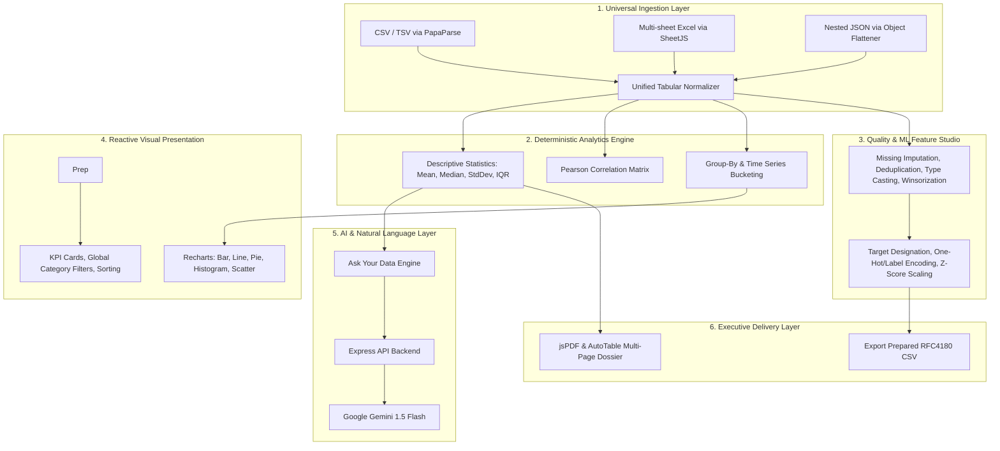

# DataLens AI 🔍
> **Tagline:** Upload. Understand. Discover.  
> *Autonomous Data Intelligence & Audited Analytics Platform*

---

## 🌟 Executive Overview & Problem Statement

Modern professionals across industries—from students and academic researchers to business owners, financial analysts, and software engineers—are inundated with raw tabular data in disparate formats (CSV, Excel workbooks, TSV, and JSON APIs). 

However, transforming raw data into reliable insights currently requires either expensive proprietary BI licenses, complex Python/Pandas coding knowledge, or blind reliance on probabilistic Large Language Models (LLMs) that frequently hallucinate statistical figures and averages.

**DataLens AI** bridges this divide. It is a full-stack, enterprise-grade data intelligence platform that ingests raw datasets, deterministically profiles data health, provides undoable data cleaning, prepares features for downstream Machine Learning, renders interactive Recharts visualizations, generates mathematically-grounded AI insights, answers natural language queries with verified evidence, and generates executive-grade PDF audit reports.

---

## 🧭 The Autonomous Data Analyst Workflow

DataLens AI behaves like an **intelligent autonomous data analyst**. Users do not need to understand statistical theory or manually configure cleaning algorithms to access insights. The default journey is streamlined:

```text
Upload Dataset
    -> Understand Dataset (Semantic profiling & Observed Facts vs Inferred Meanings)
    -> Analyze Automatically (Deterministic metric selection, distributions & correlations)
    -> Review Data Quality (Automated audit with 1-Click "Apply All Recommended Fixes")
    -> View Interactive Dashboard (Auto-selected Bar, Line, Donut, Histogram, Scatter charts)
    -> Read AI Insights (Executive narrative & verified statistical evidence)
    -> Ask Your Data (Conversational analytics co-pilot with terminology support)
    -> Download PDF (1-click executive audit dossier)
```

*(Advanced manual cleaning and prediction-ready ML preparation are available as secondary workflows for users who require granular configuration).*

---

## 🎯 Target Audience
- **Business Owners & Operators:** Rapid revenue, expense, and category breakdowns without SQL knowledge.
- **Data Analysts & Scientists:** Instant exploratory data analysis (EDA), IQR outlier audits, and ML feature pre-processing.
- **Students & Researchers:** Transparent statistical distribution testing, parametric metrics, and correlation discovery.
- **Developers & Product Teams:** Zero-setup tabular ingestion for JSON endpoints and multi-sheet spreadsheets.

---

## 🏛️ System Architecture

DataLens AI enforces a **Deterministic-First Analytical Architecture**. Mathematical calculations, correlations, IQR bounds, and aggregations are computed deterministically in code. The LLM acts solely as a semantic synthesizer, ensuring zero hallucinated numbers.



---

## ⚡ Core Features & Capabilities

### 1. Universal Tabular Ingestion
- **CSV & TSV:** Handles delimiter guessing, escaped quotes, multiline fields, and missing token detection (`NA`, `null`, `None`, `-`).
- **Excel (.xlsx):** Scans all workbook sheets and presents an interactive sheet selector modal.
- **JSON:** Recursively flattens deeply nested JSON structures (e.g., `user.address.city` $\rightarrow$ `user_address_city`).
- **Data Integrity:** Automatic column deduplication, automatic type inference (number, string, date, boolean).

### 2. Dataset Profiling & Hygiene Scorecard
- Computes overall **Data Health Score (0-100)** based on missing cells ratio and duplicate records.
- Flags potential unique identifiers (Primary Keys) to avoid meaningless aggregations.
- In-browser paginated data explorer with column-based sorting and keyword filtering.

### 3. Undoable Data Cleaning Studio
- **Missing Value Imputation:** Mean (continuous), Median (skewed), Mode (categorical), Constant replacement, or Row deletion.
- **Duplicate Records:** Deduplication with record-level change audits.
- **Outlier Normalization:** Tukey 1.5x Interquartile Range (IQR) boundary detection with Winsorization (capping) or removal.
- **Audit Trail & Rollback:** Multi-level Undo stack and one-click "Reset to Raw".

### 4. Prediction-Ready ML Feature Engineering
*(Note: Exclusively prepares datasets for external ML training. Does not train models or output pseudo-predictions.)*
- **Target Designation:** Select outcome variable with heuristic **Data Leakage Warnings** (high proxy correlation, temporal outcome naming).
- **Categorical Encoding:** One-Hot Encoding and Label / Ordinal Encoding.
- **Numerical Scaling:** Min-Max Normalization $[0, 1]$ and Standardization (Z-score $\mu=0, \sigma=1$).
- **Temporal Feature Extraction:** Decomposes timestamps into Year, Month, Day, Day-of-Week, and Weekend indicators.
- **Prepared Export:** 1-click download of prepared dataset as standardized CSV.

### 5. Deterministic Visual Analytics Dashboard
- Interactive global category filters with live cross-filtering across all cards.
- Pre-built visualizations using **Recharts**:
  - Category Volume Bar Charts
  - Proportional Donut Charts
  - Time-series Trajectory Line Charts
  - Frequency Histograms (automatic equal-width binning)
  - Correlation Scatter Plots
- **Custom Visualization Studio:** User-selectable X-axis, Y-axis, chart type, and aggregation (Sum, Mean, Count, Min, Max).

### 6. AI Insights & "Ask Your Data" Co-Pilot
- **AI Insights:** Synthesizes verified concentration ratios, top category contributors, and correlation findings.
- **Natural Language Q&A:** Ask questions like:
  - *"Which product generated the highest revenue?"*
  - *"What is the average score by department?"*
  - *"Are there missing values or outliers in this dataset?"*
- **Zero-Failure Architecture:** If the external LLM is offline or no API key is provided, the platform seamlessly uses its native deterministic query parser and calculation engine.

### 7. Executive PDF Dossier Export
- Generates publication-ready, multi-page vector PDF reports via `jsPDF` and `jspdf-autotable`.
- Includes executive metadata, data quality scorecard, full parametric statistics table, AI insights, and chronological transformation audit trail.

---

## 🛠️ Technology Stack

| Layer | Technologies |
| :--- | :--- |
| **Frontend Framework** | React 18, Vite 6 |
| **Styling & Design System** | Tailwind CSS 3, Glassmorphism UI, Lucide React Icons |
| **Data Visualizations** | Recharts 2 |
| **Parsing & Processing** | Papa Parse 5 (CSV/TSV), SheetJS xlsx 0.18 (Excel) |
| **Report Generation** | jsPDF 2, jspdf-autotable 3 |
| **Backend & AI API** | Node.js 26, Express 4, Google Generative AI SDK (`@google/generative-ai`) |
| **Testing** | Native Node.js ESM Test Suite |

---

## 🚀 Quickstart & Installation

### Prerequisites
- Node.js 18+ (tested up to Node v26)
- npm 9+

### 1. Clone & Install
```bash
git clone https://github.com/your-username/datalens-ai.git
cd datalens-ai
npm install
```

### 2. Environment Configuration (Optional)
DataLens AI functions 100% out of the box using its native Deterministic Analytical Engine. To enable advanced LLM executive narrative summaries with Google Gemini:

1. Copy `.env.example` to `.env`:
   ```bash
   cp .env.example .env
   ```
2. Open `.env` and add your Gemini API key:
   ```env
   PORT=3001
   GEMINI_API_KEY=your_gemini_api_key_here
   GEMINI_MODEL=gemini-1.5-flash
   ```

### 3. Run Development Servers
Start both the backend API and frontend Vite development server:

```bash
# Terminal 1: Start Backend Server
npm run server

# Terminal 2: Start Vite Frontend
npm run dev
```

Open your browser to `http://localhost:5173`.

### 4. Run Automated Test Suite
Verify parser compliance, mathematical correctness, cleaning operations, ML preparation, and query engine:
```bash
npm test
```

---

## 📁 Sample Datasets Included

Ready-to-use sample datasets are provided directly in the application's landing view and in the `sample-datasets/` folder:

1. `sample-datasets/Global_Tech_Sales_2024.csv` — Revenue, discount tiers, regions, and outlier high-volume hardware orders.
2. `sample-datasets/Student_Academic_Performance.csv` — Study hours, attendance rates, exam scores, and pass outcomes.
3. `sample-datasets/Corporate_Expenses_Q1_2024.tsv` — Operational expenditures, vendors, payment methods, and approval flags.
4. `sample-datasets/Orders_Nested_Data.json` — Deeply nested customer records and order items.
5. `sample-datasets/Multi_Sheet_Enterprise_Book.xlsx` — Multi-sheet Excel workbook with `Tech_Sales` and `Corp_Expenses` worksheets.

---

## 🔒 Security, Privacy & Reliability Guarantees
- **Local-First Processing:** Datasets are processed and analyzed entirely in the client browser. No customer spreadsheet data is persisted to a database.
- **Zero API Key Leakage:** Frontend code never exposes API secrets. All AI queries pass through the local Express server proxy.
- **Safe Code Execution:** No arbitrary code execution or unsanitized JavaScript `eval()` on user inputs.
- **Hallucination Prevention:** The LLM is provided only pre-calculated mathematical facts; it is strictly prohibited from inventing values.

---

## 📄 License
MIT License. Built for the competitive AI Hackathon.
